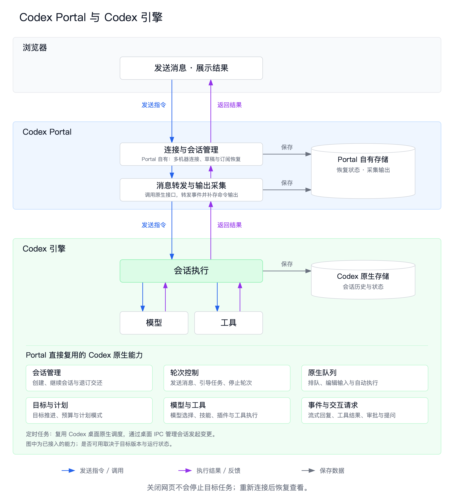

# Codex Portal

在浏览器中连接本机与远程 Codex，继续你的工作。可通过 Tailscale 在手机或另一台电脑上访问。

Codex Portal 提供网页界面，通过 Codex 原生接口读取和操作会话。任务执行与调度由 Codex 负责。

## 功能

- **会话与项目**：浏览历史、创建会话、选择项目目录，以及网页与桌面之间的会话交接。
- **消息输入**：流式回复、图片、计划、目标、原生消息队列、技能与会话引用。
- **多机器连接**：管理本机与 SSH 连接，查看目标账号及用量。
- **手机访问**：局域网 HTTPS、二维码配对，以及可选的 Tailscale 跨网络访问。
- **定时任务**：浏览 Codex 原生任务和运行记录，通过桌面管理会话发起变更。
- **数据与维护**：浏览器草稿导入导出、Codex Portal 数据加密备份、网页更新与失败回退。

## 架构

Codex Portal 负责网页交互、连接管理和输出采集。会话执行、模型与工具调用、队列和目标由 Codex 原生引擎负责。定时任务管理通过 Codex 桌面接口完成。



[查看高清图](docs/assets/codex-architecture.png) · [查看 SVG 源图](docs/assets/codex-architecture.svg)

## 环境要求

当前网页服务的安装与部署支持 **macOS**，使用 launchd 管理后台服务。

| 用途 | 要求 |
| --- | --- |
| 安装与运行 | Node.js 22.12+（含 npm）、Python 3、Git、已安装并登录的 Codex |
| SSH 目标 | 可访问的 SSH 服务、已核验的主机公钥，以及目标上的 Codex 和 Python 3 |
| 加密备份（可选） | age、age-keygen |
| 跨网络手机访问（可选） | 两端加入同一 Tailscale 网络 |

Homebrew 仅用于自动准备缺少的系统工具。局域网访问不需要 Tailscale。安装和运行不要求浏览器自动化工具或 GitHub CLI。

## 快速开始

克隆本仓库并进入目录，然后执行：

```sh
npm ci --ignore-scripts
npm run doctor
npm run init
npm test
npm run deploy -- --ref HEAD
```

打开本机网页：[http://127.0.0.1:4317](http://127.0.0.1:4317)。

如果 Codex 不在默认位置，初始化时指定路径：

```sh
npm run init -- --binary /absolute/path/to/codex
```

也可运行 `sh scripts/bootstrap-macos.sh` 完成工具检查、依赖安装、初始化、测试与部署。它会通过已有的 Homebrew 补齐缺少的 Node.js、Python 3 和 age，不安装或修改 Codex。

部署要求工作目录干净，且当前提交已通过测试。`npm install` 不会启动或部署服务。

## 通过 Tailscale 远程访问

先在 Mac 完成上面的安装步骤。

1. 在 Mac 和访问设备上安装 Tailscale，加入同一 Tailscale 网络。
2. 在 Mac 打开 Codex Portal，进入“工作区详情 → 手机访问”。
3. 展开“Tailscale · 跨网络访问”，点击“开启 Tailscale 访问”。
4. 在已连接 Tailscale 的设备上打开生成的 HTTPS 地址，按页面提示完成配对。

现在可以选择项目、发送消息或查看任务进度。Mac 需保持开机、联网且服务运行。此方式无需安装局域网证书。

配置与故障排查见[远程访问指南](docs/usage.md#通过-tailscale-远程访问)。

## 使用

在网页中选择目标机器和项目，发送首条消息后创建会话。SSH 连接在“工作区详情 → 设置 → 目标机器连接”管理。

如果只在同一 Wi-Fi 下使用，可选择“开启同一 Wi-Fi 访问”。按页面提示安装并信任证书，再扫码配对。此方式不需要 Tailscale。

配置默认保存在 `~/Library/Application Support/RemoteCodexManager/connections.json`；可用绝对路径 `RCM_CONFIG` 指定其他位置。连接配置、运行状态与源码分开保存。

项目原名为 Remote Codex Manager。为兼容已有安装，数据目录、launchd 服务标识、`RCM_*` 环境变量和内部协议标识沿用旧名称。工程目录使用 `codex-portal`。

详细说明见[使用与运维指南](docs/usage.md)。

## 限制与安全

- 网页会话固定使用“完全访问”。请仅连接你信任的目标，并保护手机配对与网络入口。
- 同一会话同一时间只从一个入口操作；当前没有跨入口控制锁。
- 普通断开和网页更新不会停止目标任务。停止目标服务或原地恢复需单独完成维护检查。
- 部分能力依赖 Codex 内部版本化接口，升级后可能需要更新适配。定时任务管理需要兼容的 Codex 桌面保持运行；SSH 目标的桌面任务管理尚未完成真实验证。
- 备份只覆盖 Codex Portal 自有数据，不包含完整 Codex 会话、Codex 登录凭据或 SSH 私钥。草稿与缓存仍可能包含敏感内容。

## 开发

前端使用 React、TypeScript、Zustand 和 Vite。服务端使用 Fastify。原生 RPC、IPC 与 SSH 适配位于 `lib/`。

```sh
npm run typecheck
npm run build
npm run start:preview
```

预览地址：[http://127.0.0.1:4327](http://127.0.0.1:4327)。

启动器自动创建独立状态目录。修改源码后需重新构建。预览连接真实目标，请使用专用测试会话。

```sh
npm test
```

测试入口包含构建、Node.js 和 Python 回归。UI 变更还需检查桌面、移动设备模式、键盘与输入行为；浏览器工具不限。

提交问题时，请附版本、复现步骤和脱敏日志。开发流程见[开发指南](docs/development.md)，项目约定见 [AGENTS.md](AGENTS.md)。

## 文档

- [Tailscale 远程访问](docs/usage.md#通过-tailscale-远程访问)
- [配置与连接](docs/usage.md#配置与运行)
- [安装指定版本与回退](docs/usage.md#安装指定版本与回退)
- [连接和维护](docs/usage.md#连接和维护)
- [加密备份](docs/usage.md#加密备份)与[恢复](docs/usage.md#恢复)
- [开发指南](docs/development.md)

## 许可证

[Apache License 2.0](LICENSE)
